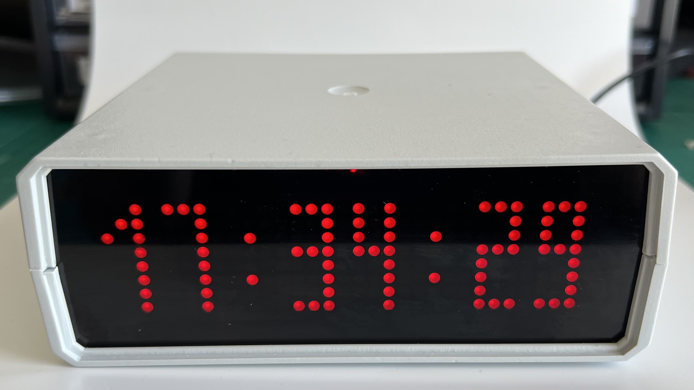
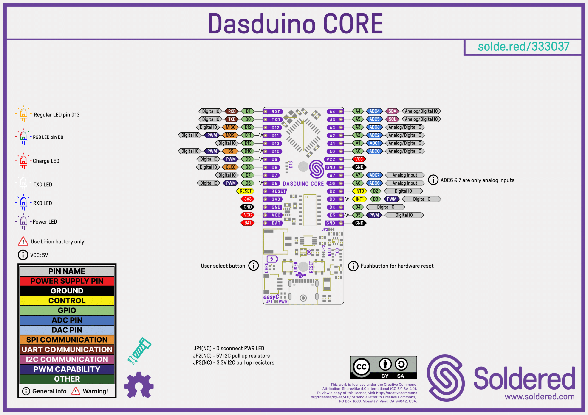
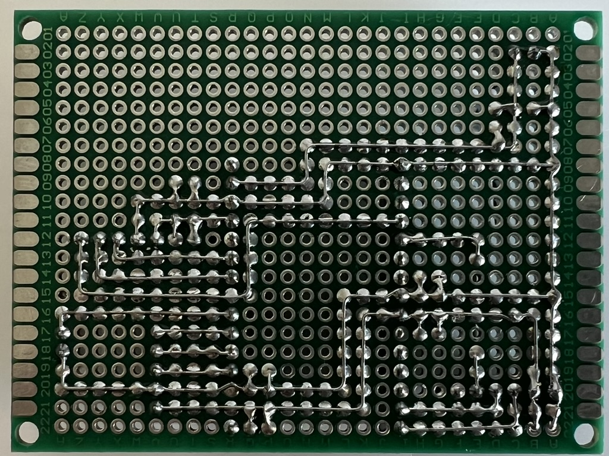
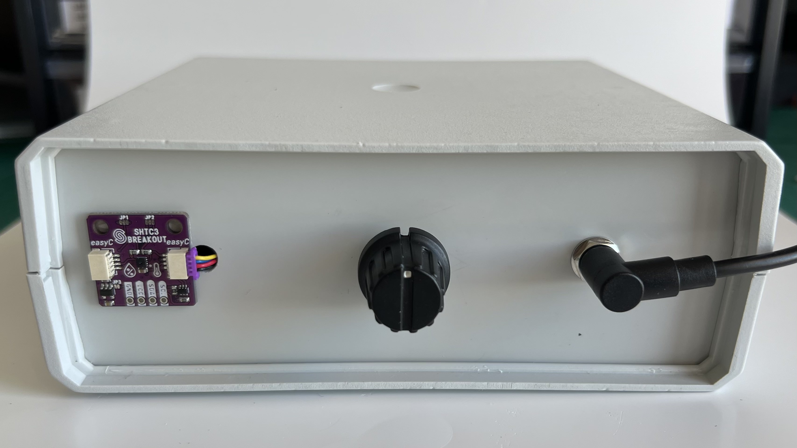
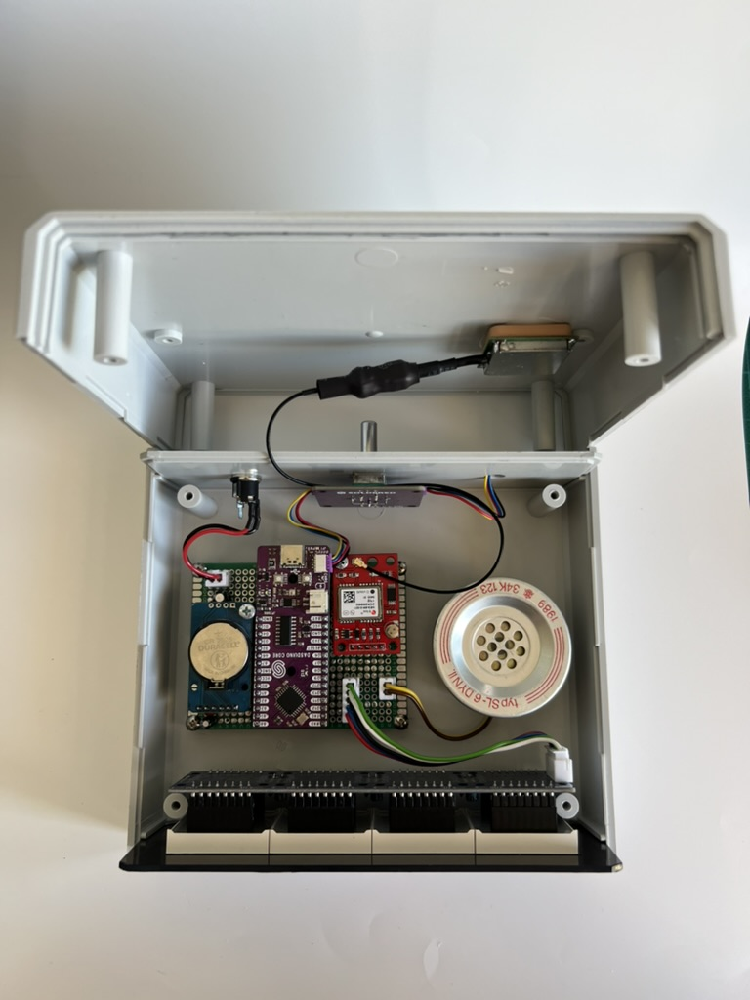
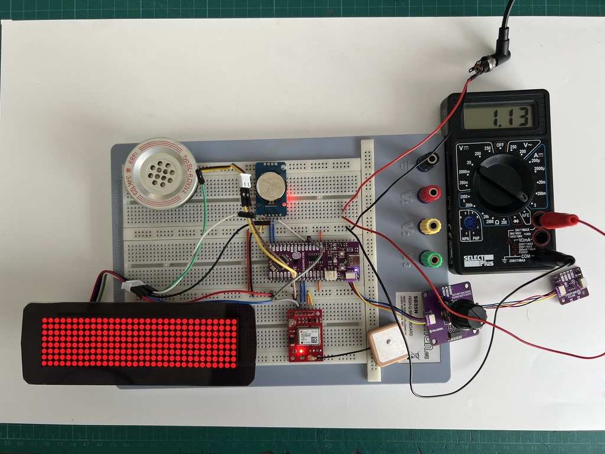
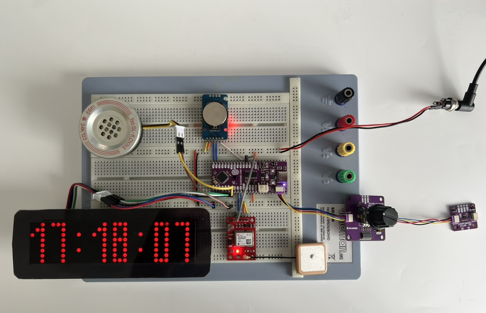

# GPS Synchronized Clock

[](LICENSE)
[](LICENSE-hardware)
[](#hardware)

A highly accurate digital clock that disciplines its time to GPS. Measured
deviation is **under 100 ms** relative to internet atomic-clock references, with
a DS3231 RTC as backup when GPS is weak. Time and temperature are shown on an
8×32 LED matrix, with alarm, timer and stopwatch functions navigated by a rotary
encoder.



## Features

- 8×32 LED matrix display, brightness adjustable in 15 steps
- Two selectable fonts
- Rotary-encoder menu navigation
- Time & temperature display, alarm, timer, stopwatch
- Speaker for the alarm
- RTC backup when GPS signal is weak
- Settings retained across power loss (EEPROM)

## Repository layout

```
firmware/    Arduino sketch + custom MAX7219 library, PlatformIO config
hardware/    bill of materials
docs/        schematic, datasheets, pinout, photos, project report
```

## Hardware

Built on the **Dasduino CORE** (ATmega328P, Arduino-compatible). Full parts
list: [hardware/bom.csv](hardware/bom.csv).

| Qty | Part | Notes |
|-----|------|-------|
| 1 | Dasduino CORE (ATmega328P) | MCU board |
| 1 | NEO-6M | GPS module |
| 1 | DS3231 | RTC (battery-backed) |
| 1 | MAX7219 8×32 matrix | Display |
| 1 | Rotary encoder (Soldered) | Menu input |
| 1 | SHTC3 (Soldered) | Temperature sensor |
| 1 | Active GPS antenna + SMA→u.FL | — |
| 1 | Speaker | Alarm |
| 1 | 100 µF + 8× 10 µF + 8× 100 nF | Decoupling |

Datasheets: [DS3231](docs/datasheets/DS3231_datasheet.pdf) ·
[NEO-6M](docs/datasheets/NEO-6M_datasheet.pdf) ·
[MAX7219](docs/datasheets/MAX7219_datasheet.pdf) ·
[MAX7219 matrix](docs/datasheets/MAX7219_LED_matrix_datasheet.pdf) ·
[SHTC3](docs/datasheets/Soldered_SHTC3_datasheet.pdf) ·
[Dasduino CORE](docs/datasheets/Dasduino_CORE_datasheet.pdf)

### Dasduino CORE pinout



### Board

| Perfboard (bottom) |
|--------------------|
|  |

### Schematic


## Firmware

Wire, EEPROM and SoftwareSerial ship with the Arduino AVR core. Additionally
required: **RTclib** (Adafruit), **TinyGPSPlus** (Mikal Hart), and Soldered's
**rotary encoder** and **SHTC3** libraries. The **MAX7219** driver is a custom
library included in `firmware/gps_clock/`.

Build and upload instructions (Arduino IDE and PlatformIO): see
[firmware/README.md](firmware/README.md). For upload, use the **Arduino Nano /
ATmega328P (Old Bootloader)** profile.

## Usage

| Front | Back |
|-------|------|
|  |  |

Inside:



- Rotate the encoder to move between time display, alarm, timer, stopwatch and settings
- Press to confirm the selected option or setting
- In alarm / timer / stopwatch: a short press cycles the digit group being
  adjusted (hours, minutes, seconds); a long press confirms
- In settings: short press enters, long press confirms, double press goes back
- Settings include font (HH:MM or HH:MM:SS), brightness (15 steps), all-alarms
  off, daylight-saving on/off, and reset-all

## Measurements

Maximum current consumption:



## Troubleshooting

Prototype on the breadboard:



| Symptom | Fix |
|---------|-----|
| GPS won't communicate with the board | Swap TX/RX pins or change baud rate |
| PPS LED on the GPS doesn't blink | Check antenna connection; reposition the antenna |
| GPS time is a few seconds fast | Wait for the receiver to download ephemeris data |
| GPS receives no data | With a clear sky view, use a higher-gain antenna |
| GPS unreliable | Check supply; add 10 µF + 100 nF close to its power pins |
| RTC drifts, loses a second every few minutes | Check supply; add 10 µF + 100 nF close to its power pins |
| Matrix shows random characters | SPI wiring problem — check connections |
| Matrix causes interference | Add 10 µF + 100 nF to each matrix module's power pins |
| Matrix stuck glowing (won't exit TEST) | Check config in code and wiring |
| Dasduino CORE errors on upload | Use Arduino Nano + ATmega328P (Old Bootloader) |

## Creating fonts

Fonts were made with the [MD Parola Font Editor](https://pjrp.github.io/MDParolaFontEditor),
which supports variable-width characters. Background reading:
[Parola fonts A to Z](https://arduinoplusplus.wordpress.com/2016/11/08/parola-fonts-a-to-z-defining-fonts/).

## License

- **Firmware:** MIT — see [LICENSE](LICENSE)
- **Hardware** (schematic, layout): CERN-OHL-W v2 — see [LICENSE-hardware](LICENSE-hardware)
- **Docs & media** (photos, pinout, report): CC-BY-4.0 — see [docs/LICENSE](docs/LICENSE)
